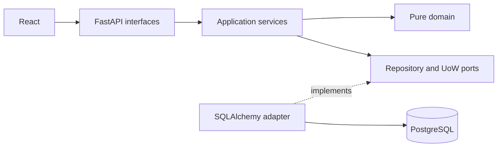
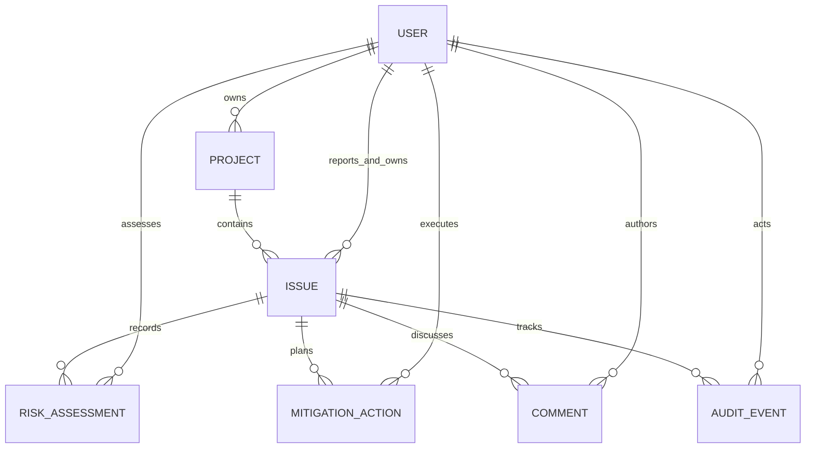

# SIGNAL

**From risk to resolution.**

## Overview
An enterprise issue, risk and corrective action workspace for the FHNW AI-assisted
Software Development capstone, Autumn 2026. The application uses persistent
PostgreSQL data and enforces its workflow on the server.

## Key Features
- Database-derived overview, issue-flow/risk/project charts, interactive 5 × 5 risk matrix and project summaries.
- Searchable, sortable, paginated issue register with status, severity and project filters.
- Create/edit issues, assign accountable owners, and track due dates.
- Immutable risk assessments, searchable history, comments and structured audit events.
- Mitigation planning, owner/manager action updates, completion and cancellation.
- Evidence-based resolution, reopening, atomic transactions and stale-write protection.
- Light, dark and system appearance, a shared desktop/mobile page toolbar, a collapsible sidebar with an icon rail, self-hosted Inter, custom controls and hidden scrollbars.
- Persistent Settings for density, motion, default chart range and background refresh; solid shared header/sidebar surfaces and a square risk matrix.
- Role-focused home views: portfolio overview for admins, project priorities for managers, personal work for members.
- A dedicated Charts view for every role, risk trends directly on issue pages, live command search (⌘/Ctrl K), and a minimal app shell without a footer.
- Additive fictional seed: 6 people, 4 projects, 529 issues, 2,800+ assessments, 1,500+ actions and 8,700+ history entries spanning about 14 months. New cases have irregular timing and varied reviews/actions; existing demo edits are preserved.
- Automatic 30-second refresh, a default 365-day history, selectable 30/90/180/365-day ranges, and charts for risk, issue flow, open workload, mitigation pace and category exposure.
- Smooth sidebar transitions, animated chart entry, reduced-motion support, shared KPI cards, filled search fields, surfaces without shadows and full background blur behind dialogs.
- Soft risk badges, a count-focused matrix without entrance animation, and a shared-style discussion composer.

## Technology Stack
Python 3.12+, FastAPI, SQLAlchemy 2, Pydantic 2, Alembic, PostgreSQL 16.
React 19, TypeScript, Vite, Tailwind CSS, Radix dialog primitives, Lucide,
TanStack Query, React Router, React Hook Form, Zod and Recharts.
pytest, HTTPX, Ruff, Vitest, Testing Library, Playwright, Docker Compose and GitHub Actions.
Python and npm dependencies are locked.

## Architecture

Every issue mutation locks its parent row and checks `expected_version`. Business
records and audit events commit together. See [architecture](docs/ARCHITECTURE.md)
and [proposed decisions](docs/adr/ADR-001.md).

## Domain Model

Risk = likelihood × impact. Scores 1–4 are Low, 5–9 Moderate, 10–16 High,
17–25 Critical. Resolution requires completed mitigation and a strictly later
reassessment. Cancelled actions remain in history. At least one DONE action
is necessary for resolution, including an otherwise all-cancelled plan.

## Getting Started

Run commands from this repository root. Native development requires Python 3.12+
and Node 22+. `make setup` uses `python3.12`; select your installed Python if needed.

```bash
make setup
npm run db:start
```

Keep PostgreSQL running in that terminal. Its data stays in `.local/postgres`,
on loopback port 54329. In another terminal:

```bash
make migrate
make seed
make api
```

In a third terminal:

```bash
make web
```

Open [SIGNAL](http://127.0.0.1:5178) and select **Emma Wilson** for the demo.
Defaults work without an `.env` file. Export `DATABASE_URL`, `DEMO_MODE` or
`CORS_ORIGINS` in the shell to override them. `.env.example` documents defaults;
native commands do not automatically load `.env`.

With Docker Engine/Desktop and Compose v2 installed, the alternative is:

```bash
docker compose up --build
```

The same URLs apply. Startup waits for PostgreSQL, applies migrations, seeds once,
and waits for API health before serving the frontend. Data uses a named volume.
Stop native servers first because they use the same ports. Docker is configured
but could not be executed on the implementation machine, where it was absent.

`make seed` never resets or duplicates the portfolio. Destructive reset instructions
and a confirmation-gated helper are in [the demo guide](docs/DEMO.md).

## Running Tests

Keep local PostgreSQL running. Integration tests require a database whose name
ends in `_test` and create disposable schemas, leaving demo data untouched.

```bash
make test
make lint
npm run typecheck --workspace frontend
npm run build
.venv/bin/python scripts/check-artifacts.py
npx playwright install chromium
npm run test:e2e --workspace frontend
```

Playwright starts dedicated test servers on ports 8001/5179 and a disposable schema.
Set `TEST_DATABASE_URL` to use a different isolated PostgreSQL database.
Results and known verification limits are in [VALIDATION.md](docs/VALIDATION.md).

## API Documentation
[Swagger UI](http://127.0.0.1:8000/docs), [ReDoc](http://127.0.0.1:8000/redoc),
[OpenAPI](http://127.0.0.1:8000/openapi.json), and [health](http://127.0.0.1:8000/health).
REST base: `/api/v1`. Mutations require a known `X-Demo-User` UUID and, except
creation, the issue's current `expected_version`. Errors return `code` and `message`.
Stale changes return 409 and prompt a refresh. See [API.md](docs/API.md).

## AI-Assisted Development
OpenAI Codex implemented the authorized local lifecycle. [AGENTS.md](AGENTS.md)
routes project context; [specifications](docs/specs/UC-001.md), [TDD evidence](docs/TDD.md),
[AI usage](docs/AI_USAGE.md), and the [original prompt](docs/MASTER_PROMPT.md) preserve evidence.
Human code review and formal ADR acceptance remain outstanding.

## CI/CD
[CI](.github/workflows/ci.yml) runs lint, import-boundary/artifact checks, backend tests
with PostgreSQL and coverage, frontend checks, Playwright and container startup smoke tests.
Actions are pinned to verified commit revisions. Test reports upload as artifacts.
Compose provides local delivery. No external deployment workflow or paid service is required.
GitHub Actions has not run during this local implementation.

## Demo
Follow the [five-minute walkthrough and fallback](docs/DEMO.md).
The editable eight-slide [presentation](docs/presentation/SIGNAL-capstone.pptx)
includes presenter notes. Genuine browser screenshots are in `docs/screenshots/`.
Use [PUBLISHING.md](docs/PUBLISHING.md) to publish manually after review.

## Project Structure
```text
backend/src/signal_app/
  domain/                  Entities, enums, pure rules and errors
  application/             Use cases, queries and repository/UoW ports
  interfaces/api/          Routes, validation and response contracts
  infrastructure/database/ ORM, adapters and Alembic migrations
  main.py                  Composition root
  seed.py                  Deterministic fictional portfolio
backend/tests/             Unit, PostgreSQL integration and API tests
frontend/src/              React pages, shared components and tests
frontend/e2e/              Browser lifecycle and responsive tests
scripts/                   Local DB, isolated E2E, artifact checks and reset
docs/                      Specs, decisions, evidence, demo and presentation
.github/workflows/ci.yml   Continuous validation and container smoke tests
compose.yaml               Local PostgreSQL/API/web delivery
```

## Limitations
Demo identity switching is impersonation, **not production authentication**.
Use this locally with fictional data. `DEMO_MODE=false` disables mutations.
Query aggregation loads the small portfolio into memory; large production datasets
would need database-side aggregation. Terminal actions cannot restart, and mitigated
issues must resume work before adding actions. Seed dates are fixed for October 2026,
so overdue counts change as the calendar advances. PostgreSQL 16.4 binaries are an
optional local development tool; Compose uses the maintained PostgreSQL 16 image line.
Docker execution, GitHub CI, human review and external deployment are not claimed.
