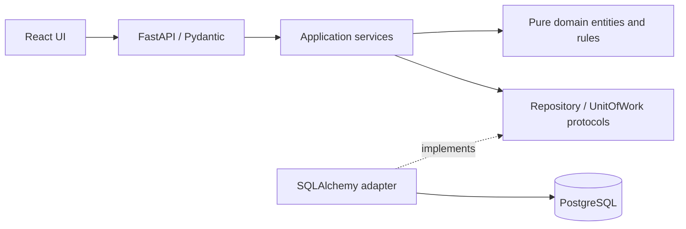

# Architecture

The composition root wires a request-scoped UoW factory into application services.
Ports exchange domain records, never ORM objects. Reads use a dedicated query
service over those same ports. API schemas are explicit contracts. A transaction
commits only after business state and audit additions succeed; exceptions roll back.

Issue rows are locked with SELECT FOR UPDATE before every aggregate mutation.
Clients send the current aggregate version; stale writes return 409. This also
serializes action completions and assessments with resolution. UUID-based human
references have a unique database constraint; collisions fail atomically.

Assessments and comments have no update/delete interface. ORM records are separate
from domain dataclasses. Foreign keys, enum checks, score checks, indexes and
uniqueness constraints provide a second persistence boundary. Migration history
is versioned and startup applies Alembic before seeding or serving traffic.

For this small capstone portfolio, query aggregation is performed on relationally
loaded records in the query service. There is no metrics cache. At larger scale,
replace this adapter/query strategy with SQL aggregation without moving business rules.

Demo identity is an explicit user selector plus X-Demo-User request header.
This is impersonation for a fictional local demonstration, not authentication.
DEMO_MODE=false disables mutation endpoints rather than implying production security.

The analytics query loads immutable assessments/events through existing ports and
replays daily status and latest-risk snapshots in a pure application module.
UTC normalization precedes date bucketing, including records returned by PostgreSQL
with a local UTC offset. Reopened issues re-enter historical active risk; resolved
issues leave it. Analytics remain derived and read-only. History filters apply
before pagination. The larger demo remains local capstone scale; aggregation is
not presented as a large-production performance design.
